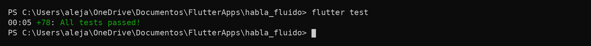

#Habla Fluido

## 1. Ronda 2 · El comparador (`comparador_test.dart`)

## 2. Ronda 2 · El comparador (`comparador_test.dart`)

## 3. Rondas 3–4 · Repetición espaciada y progreso (`repaso_progreso_test.dart`)

## 4. Rondas 3–4 · Repetición espaciada y progreso (`repaso_progreso_test.dart`)

## 5. Ronda 6 · El proxy de la IA (`proxy/test/proxy.test.js`)

## 6. Ronda 6 · El proxy de la IA (`proxy/test/proxy.test.js`)

## 7. Ronda 7 · El tutor simulado y el cliente HTTP (`tutor_test.dart`)

## 8. Ronda 7 · El tutor simulado y el cliente HTTP (`tutor_test.dart`)

## 9. Ronda 9 · ViewModels (`vms_test.dart`)

## 10. Ronda 9 · ViewModels (`vms_test.dart`)

## 11. Ronda 10 · Suite completa

